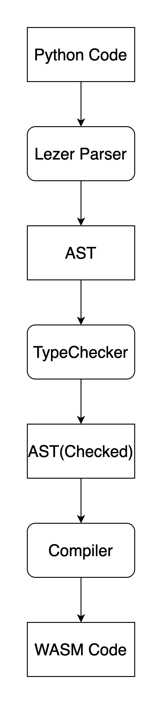

# Basic Design of Compiler

The basic task of this course is to design a compiler to translate Python program (ChocoPy limited) to WebAssembly(WASM) program. The compiler is written in TypeScript. The basic version supports variables, functions and classes without inheritance. Detailed specification could be seen below.

The whole process:



So there are three main components in the compiler.

## 1. Lezer Parser

This component includes a parser supported by Lezer, and related code to process parsing results.

Parser is used to parse original Python code to form a non-abstract syntax tree(non-AST), which looks like:

```python
a : int = 1
print(a)
```

parsing result:

```
Script
    AssignStatement
        VariableName ("a")
        TypeDef
            :
            VariableName ("int")
        AssignOp ("=")
        Number ("1")
    ExpressionStatement
        CallExpression
            VariableName ("print")
            ArgList
                (
                VariableName ("a")
                )
```

Our job is to walk through the parsing result to construct an AST for further check and compiling. Basically, we need to check the result line by line, and take different actions in front of different statements and tags. For example:

```typescript
export function traverseStmt(s : string, t : TreeCursor) : Stmt<any> {
  switch(t.type.name) {
    case "AssignStatement":
      t.firstChild(); // focused on name (the first child)
      var memExpr : Expr<any> = null;
      if(t.node.type.name == "MemberExpression") {
        var memExpr = traverseExpr(s, t);
      }
      var name = s.substring(t.from, t.to);
      t.nextSibling(); // focused on = sign. May need this for complex tasks, like +=!
      t.nextSibling(); // focused on the value expression
      var value = traverseExpr(s, t);
      t.parent();
      if(memExpr == null) {
        return { tag: "assign", name, value };
      } else if(memExpr.tag == "field_call") {
        return { tag: "fieldAssign", expr: memExpr.expr, name: memExpr.fieldName, value: value };
      } else {
        throw new Error("Parse Error: unmatched statement type: " + memExpr.tag);
      }
      ...
```

The AST is defined in the compiler:

```typescript
export type Program<A> = 
  | { a?: A, classDefs: ClassDef<A>[], varDefs: VarDef<A>[], funcDefs: FuncDef<A>[], stmts: Stmt<A>[] }

export type ClassDef<A> = 
  | { a?: A, name: string, varDefs: VarDef<A>[], methodDefs: MethodDef<A>[] }

export type VarDef<A> = 
  | { a?: A, typedVar: TypedVar<A>, value: Literal<A> }

export type TypedVar<A> = 
  | { a?: A, name: string, type: Type }

export type FuncDef<A> =
  | { a?: A, name: string, params: TypedVar<A>[], returnType: Type, inits: VarDef<A>[], body: Stmt<A>[] }

export type MethodDef<A> = 
  | { a?: A, name: string, self: Type, params: TypedVar<A>[], returnType: Type, inits: VarDef<A>[], body: Stmt<A>[] }

export type Stmt<A> =
  | { a?: A, tag: "assign", name: string, value: Expr<A> }
  | { a?: A, tag: "fieldAssign", expr: Expr<A>, name: string, value: Expr<A> }
  | { a?: A, tag: "if", condition: Expr<A>, mainBranch: Stmt<A>[], branchCond: Expr<A>, branch: Stmt<A>[], elseBranch: Stmt<A>[] }
  | { a?: A, tag: "while", condition: Expr<A>, body: Stmt<A>[] }
  | { a?: A, tag: "pass" }
  | { a?: A, tag: "return", ret: Expr<A> }
  | { a?: A, tag: "expr", expr: Expr<A> }

export type Expr<A> = 
  | { a?: A, tag: "literal", literal: Literal<A> }
  | { a?: A, tag: "id", name: string }
  | { a?: A, tag: "uniop", op: Uniop, expr: Expr<A> }
  | { a?: A, tag: "binop", leftExpr: Expr<A>, rightExpr: Expr<A>, binop: Binop }
  | { a?: A, tag: "expr", expr: Expr<A> }
  | { a?: A, tag: "call", name: string, arguments: Expr<A>[] }
  | { a?: A, tag: "obj_call", name: string }
  | { a?: A, tag: "field_call", expr: Expr<A>, fieldName: string }
  | { a?: A, tag: "method_call", expr: Expr<A>, methodName: string, arguments: Expr<A>[] }

export enum Uniop { Not = "not", Neg = "-"}

export enum Binop {
  Plus = "+",
  Minus = "-",
  Mul = "*",
  Div = "//",
  Mod = "%",
  Equl = "==",
  NotEqul = "!=",
  Le = "<=",
  Ge = ">=",
  Les = "<",
  Gret = ">",
  Is = "is"
}

export type Literal<A> = 
  | { a?: A, tag: "num", value: number }
  | { a?: A, tag: "bool", value: boolean }
  | { a?: A, tag: "none" }

export type Type = 
  | "int"
  | "bool"
  | "none"
  | { tag: "obj", class: string }

// number: int32
```

So the first component is to convert the raw Python code to a `Program<null>` object in TypeScript.

## 2. TypeChecker

TypeChecker is used to perform type check on the generated AST. For example, a line of Python code looke like this: `a : int = False` could be generated an AST successfully by the parser, but in this step, the TypeChecker would find this wrong assignment for unmatched types and throw an error. Here is a piece of TypeChecker code:

```typescript
switch(stmt.tag) {
    case "assign":
        if(!env.vars.has(stmt.name) && !env.localVars.has(stmt.name)) {
            throw new Error(`TYPE ERROR: unbound id ${stmt.name}`);
        }
        if(!env.localVars.has(stmt.name)) {
            throw new Error(`TYPE ERROR: could not assign value to ${stmt.name} that does not exist in the scope`);
        }
        var typedValue = typeCheckExpr(stmt.value, env);
        if(!assignableTo(env.localVars.get(stmt.name), typedValue.a)) {
            throw new Error(`TYPE ERROR: could not assign value of ${typedValue.a} to ${env.localVars.get(stmt.name)}`);
        }
        typedStmts.push({...stmt, value: typedValue, a: "none"});
        break;
    ...
```

Because there are different variable, function and class definitions, a global environment is needed to store available variables, functions and classes for check, like whether a function is undefined while calling it or its arguments are mismatched. Besides, we also need to distinguish whether a variable exists outside a function or inside a function, because in ChocoPy, only variables declared in the scope could be modified in the scope.

The difference between AST before TypeChecker and the AST after TypeChecker lies the existance of `a` in AST nodes. The `a` is a variable of `Type`, like an `int`, `bool`, `none` or `class`. It represents the true return type of the AST node, while the `tag` field only represents the type of AST nodes themselves. In this way, this step would output a `Program<Type>` object.

## 3. Compiler

The compiler is responsible to accept an AST and generate WASM code accordingly. For example:

```typescript
switch(stmt.tag) {
  case "assign":
    var valStmts = codeGenExpr(stmt.value, locals);
    if(locals.has(stmt.name)) {
      valStmts.push(`(local.set $${stmt.name})`);
    } else {
      valStmts.push(`(global.set $${stmt.name})`);
    }
    return valStmts;
  ...
```

As you can see, the basic ideas of the three components are the same: analyze formatted structure recrusively and generate results. For variables and functions, things are pretty straightforward, but for classes, things are a little tricky. The thing is, there is no class concept in WASM, so we need to allocate a memory space in WASM and manage our classes manually. 

For a class, there could be several variable(field) definitions and function(methods) definitions in it. So for function definitions, they could be treated like a common function with a `self` parameter. The `self` parameter could be used to indicae which concrete object calls the very function by passing itself into the function. Also, to make methods of classes distinguish from common functions, some changes of method name must be applied: Say the name of class is `C`, the name of a method is `fun1`, then the generated function name in WASM could be `fun1$C`. Because `$` is not allowed in Python function name, so the generated method name is guaranteed not to be duplicated with other common functions. Since there are no two classes could have the same class name, the generated name could also be guaranteed not to be duplicated with method names in other classes.

For class variables, they must be stored in allocated memory space, a heap. And we must maintain a variable pointing to the lowest address of free space. For a class looks like:

```python
class C(object):
  n : int = 1
  b : int = 2
  ...
```

We may create two objects of `C`:

```python
c1 : C = C()
c2 : C = C()
```

Now the heap could be:

```
----------(c1)
1
----------
2
----------(c2)
1
----------
2
----------
...
```

Addresses in the heap are stored in different object variables, like `c1` and `c2`.

We also need to record the order of fields in a class to locate respective values in memory by using `addr of obj + offset`. Because we use `i32` in WASM, the offset of each field is 4. In this way, `c1` could be 0 and `c2` could be 8.

To decide whether an object variable is None or really points to an object, we make the heap address starts from 4, instead of 0. In this way, for each object variable with value 0, we would know this variable has not been initialized and a runtime error could be thrown from WASM code (check code is needed in WASM). In this way, `c1` should be 4 and `c2` should be 8.

The generated WASM could be like this:

```
(module
(func $print (import "imports" "print") (param i32) (result i32))
(func $print_num (import "imports" "print_num") (param i32) (result i32))
(func $print_bool (import "imports" "print_bool") (param i32) (result i32))
(func $print_none (import "imports" "print_none") (param i32) (result i32))
(func $throw_runtime_error (import "imports" "throw_runtime_error"))
(memory (import "imports" "mem") 1)
(global $heap (mut i32) (i32.const 4))
(global $a (mut i32) (i32.const 1))
(global $b (mut i32) (i32.const 0))
(global $res (mut i32) (i32.const 0))
(global $r1 (mut i32)(i32.const 0))
(func $fun (param $a i32) (param $b i32) (result i32)
(local $scratch i32)
(block
(loop $my_loop
(i32.const 1)
(local.get $a)
(i32.const 10)
(i32.lt_s)
(i32.sub)
(br_if 1)
(local.get $a)
(i32.const 1)
(i32.add)
(local.set $a)
(br $my_loop)
)
)
(local.get $b)
(if
(then
(i32.const 0)
(local.get $a)
(i32.sub)
(local.set $a)
)
)
(local.get $a)
return
(i32.const 0))
(func $__init__$Rat (param $self i32) (result i32)
(local $scratch i32)
(nop)
(i32.const 0))
(func $new$Rat (param $self i32) (param $n i32) (param $d i32) (result i32)
(local $scratch i32)
(local.get $self)
(i32.add (i32.const 0))
(local.get $n)
i32.store
(local.get $self)
(i32.add (i32.const 4))
(local.get $d)
i32.store
(local.get $self)
return
(i32.const 0))
(func (export "_start") (result i32)
(local $scratch i32)
(global.get $a)
(global.get $b)
(call $fun)
(global.set $res)
(global.get $heap)
(i32.add (i32.const 0))
(i32.const 123)
i32.store
(global.get $heap)
(i32.add (i32.const 4))
(i32.const 345)
i32.store
(global.get $heap)
(global.get $heap)
(global.set $heap (i32.add (global.get $heap) (i32.const 8)))
(call $__init__$Rat)
(i32.add)
(global.set $r1)
(i32.const 0)
(global.get $r1)
i32.store
(i32.const 0)
i32.load
(if
(then
(nop)
)
(else
(call $throw_runtime_error)
)
)
(i32.const 0)
i32.load
(i32.const 1)
(i32.const 2)
(call $new$Rat)
(call $print)
(local.set $scratch)
(local.get $scratch)
)
)
```

The WASM code could then be run and some results could be expected for testing.