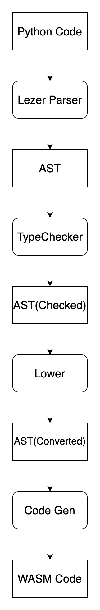

# Destructure Assignment

First of all, with the join of `Lower`, we are going to build a large compiler to exntend ChocoPy's features and supports. Now the whole process is like:



The task of my team is to finish support and compiling if destructure assignment feature.

## Basic Design

In Python, this is called destructure assignment:

```Python
a, b, c = 1, 2, 3
```

In ChocoPy, this is not supported. Our job is to introduce this feature into our large compiler. 

To be more specific, in ChocoPy, the destructure assignment would be like:

```python
a : int = 0
b : bool = False
c : Object = None
a, b, c = 1, True, Object()
```

If we dive deep, we could also see another kind of destructure assignment, which is combined with list or set or tuple at right hand side:

```python
a : int = 0
b : bool = False
c : Object = None
a, b, c = [1, True, Object()]
```

The list implementation is finished by another team, and they have confirmed that there could only be the same type of elements in a list, which denies the possibility of the above snippet. However, a simplified version like this:

```python
a : int = 0
b : int = 0
c : int = 0
a, b, c = [1, 2, 3]
```

should work.

There are also some special symbols in Python, like `_`(ignore elemention in this position) and `*`(represents an assignment for a list). Here is an example in the below snippet:

```python
a : int = 1
b : [int] = None
a, _, *b = 1, 2, 3, 4
```

However, in our final implementation, we stopped before implememting `*`, which is far more complicated than we expected, while we did implement the `_`.

Besides, the expressions at the RHS could not only be a plain format like `1, 2, 3` or `[1, 2, 3]`, they could also be something like iterator or an id which represents a list or a tuple, like:

```python
a : int = 0
b : int = 0
c : [int] = None
c = [1, 2]
a, b = c
```

However, this is not easy for us to implement, so that we made a compromise on this: so all this kind of list, tuple or set should firstly be converted to iterators, and then we could use these iterator to traverse around them. For example:

```python
class iterator(Object):
    start: int = 0
    end: int = 0

    def next(self: iterator)->int:
        output: int = 0
        if self.start < self.end:
            output = self.start
            self.start = self.start + 1
            return output
        return -1

    def hasNext(self: iterator)->bool:
        return self.start < self.end

def range(s: int, e: int)->iterator:
    it: iterator = None
    it = iterator()
    it.start = s
    it.end = e
    return it
  
a : int = 0
b : int = 0
a, b = range(1, 3)
```

So this is the basic design for destructure assignment in the large compiler:

```python
a, b, c = 1, 2, 3
a, b, c = [1, 2, 3]
a, b, c = (1, 2, 3)
a, b, c = <iterator>
a, _, c = 1, 2, 3
```

## Implementation Details

### Parser

In the parser, the line of code `a, b, c = 1, 2, 3` would be parsed into:

```bash
AssignStatement
    VariableName ("a")
    ,
    VariableName ("b")
    ,
    VariableName ("c")
    AssignOp ("=")
    Number ("1")
    ,
    Number ("2")
    ,
    Number ("3")
```

In this way, there shall be a while loop when parsing the RHS expression, until reaching the end of the expression.

On the other hand, this line of code `a, b, c = [1, 2, 3]` would be interpreted into:

```bash
AssignStatement
    VariableName ("a")
    ,
    VariableName ("b")
    ,
    VariableName ("c")
    AssignOp ("=")
    ArrayExpression
        [
        Number ("1")
        ,
        Number ("2")
        ,
        Number ("3")
        ]
```

In AST, we defined the RHS expression as `{  a?: A; tag: "array-expr", elements: Array<Expr<A>> }`, while the list team defined the list as `{  a?: A, tag: "construct-list", items: Array<Expr<A>> }`. As I have mentioned, elements in a list should be always the same type, while in the plain format, it is not necessary to be the same type. So at the very beginning, we used the `construct-list` to represent all RHS expressions incluing plain format expression, and found out that this implementation did not meet our requirements. So that we finally kept both `array-expr` and `construct-list` to represent different kinds of RHS expression(`array-expr` stands for plain format expression).

### Type Checker

The type checker processes the destructure assignment as if it was the original simple assignment in most cases with a for loop traversing around the destructure elements. However, this would not work when the RHS expression is a iterator, which requires the runtime check instead of static check. In this case, we only need to check whether the LHS elements are the same type(or is assignable) with the type returned by the iterator.

Also, for a destructure assignment node, the RHS elements could be an id, a field lookup or an index:

```python
a, obj,c, l[1] = 1, 2, 3
```

In this way, the type checker should be able to process the three types of elements.

### Lower

Lower is related to ir, which is used to simplify the design. In this part, destructure assignment is converted back to simple assignment:

```python
a, b, c = 1, 2, 3
```

to

```python
a = 1
b = 2
c = 3
```

More details would be skipped here.

## Test Cases

it is always important to have enough unit tests and end-to-end tests to guarantee correctness of our code. For test case details, you could refer to the test code in `destructure.test.ts`.