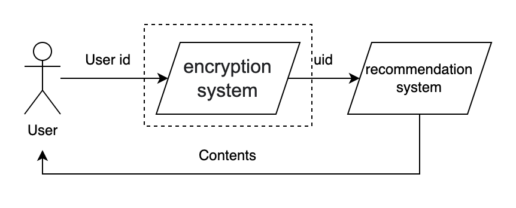

# Data Collection and Measurement System

Recommendation system relies on user behavior data heavily, in order to make the best guess on what a certain user would be interseted. Though in my recommendation system, I would not only focus on finding out what users are interested in, these behavior data would also be needed. 

## Data Collection

In my model, I would make use of the collaborative filtering technology as the recommendation system algorithm. In this algorithm, users' behaviors are required: we need to record what contents a user is interested in(like having viewed or bought), and use some similiarity functions to determine some other users that are similar to the user by calculating their distance(how similar they are) with their interested contents. In these similar users, we would select some contents that the original user has never seen as recommendation contents. This is what a common recommendation system needs, and since my work would be based on the general one, I also need to collect these behavior data.

To be more specific, given a dataset including contents and users:

| User id  | Content id | Other features |
| -------- | ---------- | -------------- |
| u0000001 | c0000001   | ...            |
| u0000001 | c0000003   | ...            |
| u0000002 | c0000001   | ...            |
| u0000002 | c0000002   | ...            |
| ...      | ...        | ...            |

For a website or a platform, it is natural for them to record their users' behaviors, or logs. These data could be as detailed as including who the user is, what content the user has viewed, what device the user used, when the view happened and many other information. 

Besides, there could be a more specific dataset recording what users are interested and not interested. There exisits a lot of platforms that allow users to manually select what they are interested and not interested(or blocked) contents. In this kind of dataset, contents would be divided into different categories with different tages, and the user could select these tags to show their preference. This information would also be helpful.

## Measurement System

The basic principle to determine the measurement system, is to use as little data as possible. In the user behavior dataset, to finish the collaborative filtering job, I only require the user-content tuples to construct the UI matrix. For the user interest tag dataset, I would require the part of what tags a user is not interested to filter the recommendation results. The collaborative filtering algorithm is useful, while it does suffer from slow response to users' changed interests. With the help of manualy taged contents, I could make a quick response to this.

The measurement system is not biased, because the main recommendation system is only making use of users' behaviors, instead of specific characteristics of users, like sex, race and age. But there could be other ethical concerns.

## Ethical Concerns and Responses

### Privacy Concern in Data Collection

Some users may simply refuse to give away their browsering or bought lists, for different reasons. Some may worry about potential leakage of their data which would make their privacy exposed. For these users, an encryption could be introduced. The goal of the very system is to break the connection between the real user and the user I would use in the recommendation system. Users would be acknowledged that their real identification would not be used in recommendation procedure, and researchers and engineers would never see their records with their own eyes: because it is unnecessary at all. 

The whole process could be like:

The encryption system would be isolated form other parts, and internal staff would have no access to the system. The encryption system would also be well protected from external attack to ensure hackers would not gain access to the system. In the wrost scenario, a hacker has got the uid and contents related to the uid, the hacker still could not know which real person these contents belonging to, with the access to the encryption system. 

I also found that this concern could come from the untransparent recommendation procedure, and it could be critical to receive acknowledged consents from users. Nowadays, tech companies may not be willing to make their tech details transparent to their users, which would definitely lead to distrust between companies and their users. By making the protection methods clear to users, we could expect a positive loop between users and companies.

It could also be possible that some users just do not care about protection that would be used, and refuse to give their consents to make use of their data. In this scenario, I believe it is important to respect users' willings and stop this kind of recommendation. Other recommendation rules like random recommendation or popular item recommendation could be applied instead.

Some other users may worry about how long their data would reside in our system. In this way, I think it could be helpful to make a detailed data retirement policy: for all the data used for recommendation, we could only keep the most recent two year data(or other reasonable boundaries). Data that is older than the boundary would be swaped away from the system. In fact, this is not only useful to relieve the ethical concern, but also helpful to solve stale recommendation issue.

### Unfaireness in Measurement System

It could be very common to face cold start or missing data problem in recommendation system. For a new user, or missing data user, the contents recommended to them could be tricky. For example, some recommendation systems would treat these users as average users, and recommend some popular items to them simply in the view of result. This looks fine and safe in most cases, but it could also look like some suspicious guidence from the platform. I would suggest to make use of the tag selected by these users, if any, to determine what the fisrt batch of recommended contents should be. And if there is none, we could select some contents from all categories as recommendation, instead of just some popular items. It would be important to give away the right of choice to users, instead of treating them as some average users to earn trust. 

Beyond the above issue, the distribution of data is also unfair. Some users are more active with much more behavior records than others, or they are celebrities with many fans, and then they could be opinion leadership. In this way, their weight is in fact greater than others, given there are many other users following their behaviors. In this way, the recommendation system would recommend more and more contents that follow their interests to other users, which would form a feedback loop to enhance their leadership position. In the end, we are not evaluating the similarity between users, but between users and these leadership users. I plan to give a way to detect users in dataset that are *too similar* to each other, and turn down their weights to reduce the influence to the whole recommendation system. This is also an effort towards diverse recommendation results. 