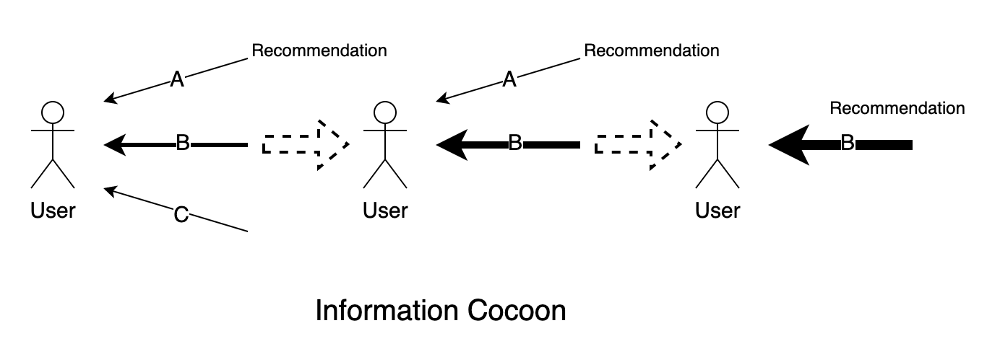
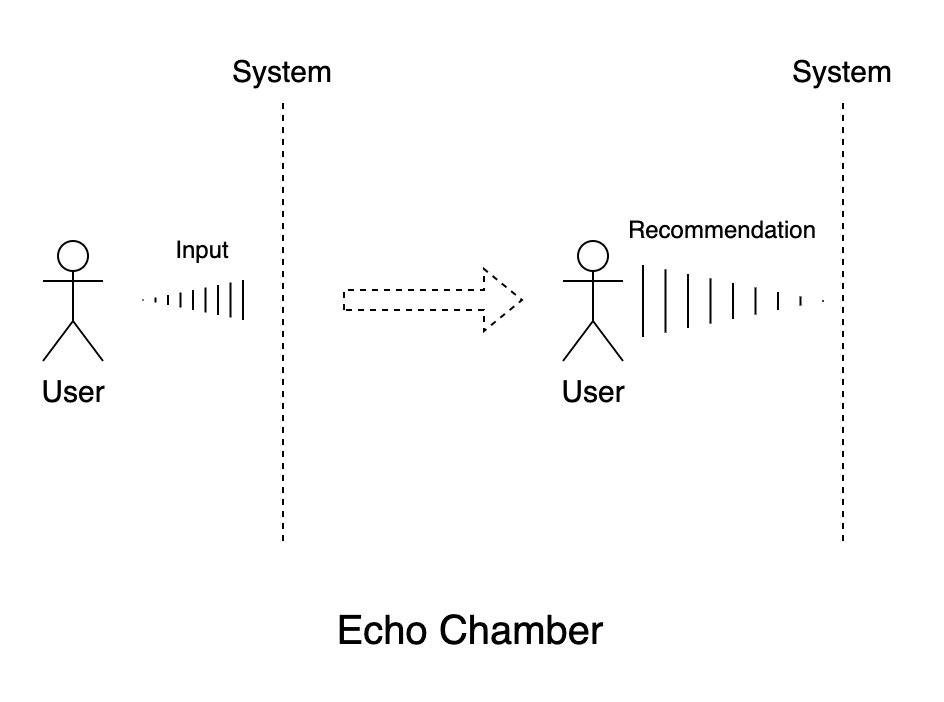
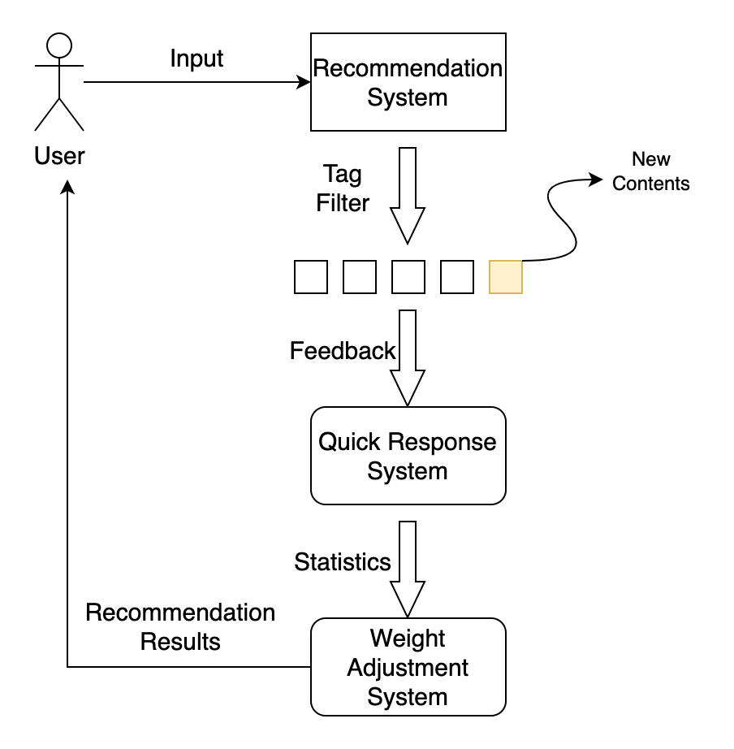

# Ethical Concerns in Analyzing and Modeling

## Information Cocoon and Echo Chamber

One common ethical concern in recommendation systems could be their limited recommendation contents. To be more specific, a recommendation system could only recommend what it believes the user is interested in to this user. This is for making more profits by keeping users' attention on the platform, or just making users click in what is recommended. In this way, the safest way for recommendation systems is to only recommend the contents with the greatest possibility being interested in.

In business, this kind of models works fine, and they could make their goals: making more profits. However, by only recommending limited contents could keep users in their own loops. This is called *information cocoon*. In my view, information cocoon partialy violates users' initial consents: In the very beginning, users may think the platform or website would recommend something interesting and new to them, which could make them expand their views and enjoy the platform or webiste better. However, the fact is that only contents that fall in users' loops would be recommended to them to make more profits. This is somewhat, though not obvious, a violation of the initial consents.

Information cocoon not only limits users' views, but could also lead to some bad results. For online news websites or social medias, their recommendation could represent some kinds of views, ideas and opinions, which would potentially influence people's minds seeing them. This would be pretty harmful and dangerous with some extreme views. Some users may only have some blur thoughts on some ideas initially, but by being recommended more and more similiar contents to enhance their blur ideas, they could be more and more extreme. This is called *echo chamber*. We have already seen a number of tradegies caused recently by extremists, and it could be really necessary to control the sources.

The key to answer this concern is diversity in views. By giving more chances to users to see different contents, they could enjoy benefits from different aspects, including their views and mental health. In a techinical view, I should make some modification on the recommendation algorithm details: Originally, the recommendation system would only recommend top n most similiar new contents, without considering other consequences. An acceptable solution could be select some contents that are not that similiar, while helpful to make users hear different voices. There should be a reasonable ratio, like 80% similiar contents, 20% different contents. 

On the other hand, what users could see is not only generated by the recommendation system. In this way, I also think it important to corporate with other systems, or there should be a global policy for the platform to encourage users to contact different things. This could be a complete solution to break infomration cocoom and echo chamber.

## Biased and Unfair Recommendation Results

Is recommendation alway justice and fair? The answer is no. Companies and individuals could decide to pay for gaining more exposure in recommendation results, and of course some contents would not be recommended to users because of limitation of display spots on UI. And active users' behavior may have greater weight in recommendation systems because of greater quantity, which may force all users to merge into the main stream, but ignoring their own interests. In these scenarios, users are guided by biased and unfair recommendation results, and those losing opportunities of being recommended may suffer.

For the first part, is the way paying to gain more recommendation chances ethical? I think it depends, or it could be acceptable or unacceptable. Generally speaking, it would be more likely to be unacceptable if the recommendation results are tied to some important decisions of users, like medicine or financial suggestions. There could be law requirements in the United States, but this could also be disasters in other countries, and this is why I would like to talk about it here. It would be impossible to delegant the power to the model to decide which is ethical and which is not, and human review must be involved. I would not expand too much on human part, but it is good idea to mark all payed-to-display contents to remind users. I prefer to return the right back to users to let them decide whether to click in or not, instead of prentending these contents as normal ones.

The next part is the potential unfairness for contents that are not recommended. This is also related to the last part: greater weight form active users, or opinion leadership, which has been discussed in last chapter for data collection. In this chapter, considering the continous running of the model, we would gather and store more and more data, so the procedure of identifying opinion leadership could also be a long-term job. By adjusting the weights of opinion leadership users, the model is expected to be more just and fair on this aspect. Beyond this procedure, I would also modify the recommendation preference for the 80% similiar contents: instead of top n most simliar contents, the chance that has been recommended of each content would also be taken into consideration, and those with smaller chance being recommended would gain greater weight when making recommendation. The goal here is to make all contents gain the chance of being recommended they deserve, not to make all of the contents enjoy the same recommendation chance. In this way, feebacks from users are important. If some contents go with relative poor feedbacks, the recommendation adjustment procedure would not be applied to them later on.

(This part is partially being inspired by https://www.searchenginejournal.com/biases-search-recommender-systems/339319/)

## Improper Recommendation Results

Besides the Reconnect Program of Facebook mentioned in lecture, there could also be a similar scenario: similar goods are still recommended to users even after users have bought one. This may be frustrating when there are many unnecessary recommendations, and it could be worse after users have found a better choice and become regretful. So the delay of recommendation system without a quick response to people's interest change is also what current people concern. My solution to this is to build a quick response system: if a user has clicked in what the model has recommended, or bought the recommended goods, the model would mark related contents to reduce their weights when making next recommendation. The reduce in weights would be kept until the user clicks in similiar contents again, which indicates that the user is still interested in this kind of contents. On the other hand, the feeback system is also important. General recommendation systems always come with a button of "not interested" for each content recommended, which the button rarely works, unfortunately. So an essential way of the quick response system is to make this feedback mechanism work as expected.

Finally, the whole system may look like:

