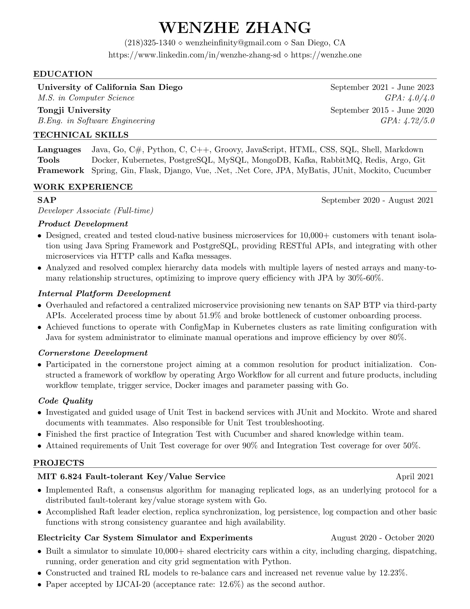

# Wenzhe Zhang's Notebook

Hi there, I am Wenzhe Zhang (张文喆), I am currently a graduate student in *University of California, San Diego*, majoring in Computer Science, and expected to graduate in December 2022 or Match 2023. I am currently working at *Google* as a SWE intern at Google Payment team, based in Sunnyvale. Before I went to my graduate school, I worked at SAP for about year as a backend developer, using Java and Go to build microservices. 

This is my notebook to record my working, reading and learning materials, and I am more than happy to share them to everyone. 

If you have any questions, or just want to contact me, please send emails to me directly: wenzheinfinity@gamil.com

Currently collected:



This is my resume:

